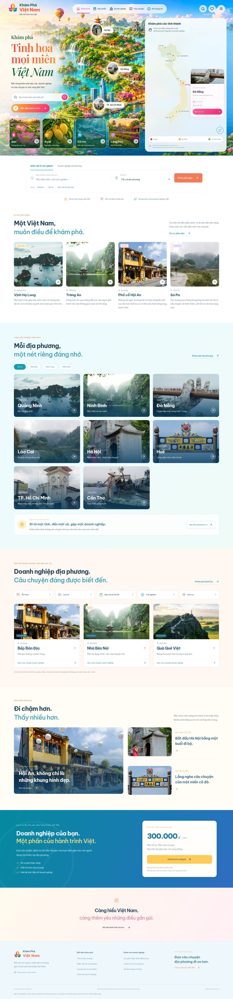

# Khám phá Việt Nam

A separate, colorful travel and local-business discovery prototype with ocean blue, coral, sunshine yellow, pastel sections and approachable sans-serif typography. One codebase generates province, commune, destination and business-profile pages; businesses are data records, not independent GitHub repositories or Vercel projects.



[Mobile preview](docs/previews/mobile.jpg)

## Included

- Vietnamese homepage with an original AI-illustrated panoramic hero, frosted navigation, colorful specialty themes, an interactive eight-locality schematic and destination/business search.
- Eight province pages, two commune/ward pages, eight destination pages and eight clearly labeled sample business profiles.
- Working province/category/text filters, empty states, breadcrumbs and navigation between levels.
- Business plan presentation at **300,000 VND/year**.
- Registration draft: browser validation, preview, optional local-device save and JSON export.
- Mobile navigation and back to top; image sources and attribution page.

**This is a prototype.** No real account registration, database writes, payment collection, verified businesses, national administrative dataset or moderation backend is connected. The form does not claim it submitted data or accepted payment. Placeholder business names are illustrative. All pages default to noindex/nofollow until content is approved for production.

## Run

```sh
npm ci
npm run dev
```

Production checks:

```sh
npm run check
npm run build
npm run start
```

No external service credentials are required for the demo. Use Node.js 20.9+.

## Deploy

Import `lnguyen2k10/kham-pha-viet-nam-16112026` as a separate Next.js project in Vercel. Default build and output settings work. No effect on the existing Fit Club demo repositories/projects.

## Long-term architecture

**[Hạ tầng và vận hành — tiếng Việt](docs/HA-TANG-VA-VAN-HANH.md)** covers ownership, roles, PostgreSQL/Auth/Storage, the annual plan, moderation, payments, stable administrative IDs, cache/SEO, backups and phased launch. These production features are recommendations, not claims that they already run in this demo.

Images: Wikimedia Commons with author/license links in `/nguon-anh`, plus selected Unsplash landscape photographs. Image data and credits are included in the source. Landscape images in business profiles are labeled as illustrations, not storefront photos.

[Hướng mở rộng bản đồ và cộng đồng 3D](docs/LO-TRINH-BAN-DO-VA-CONG-DONG-3D.md) — proposal only, not a shipped feature.

## Validation

TypeScript and production build passed. Browser checks passed at 360, 390, 768, 1024 and 1440px: navigation, destination search, province → commune → business, business filters/empty state, registration validation, preview, explicit local draft restore and JSON export. No browser page errors in the tested flows.
