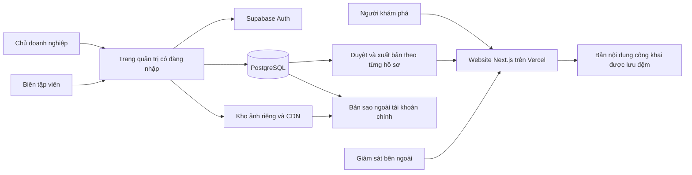

# Khám phá Việt Nam — Hạ tầng và vận hành dài hạn

## 1. Quyết định kiến trúc

Một nền tảng chung, một repository sản phẩm và một ứng dụng công khai. Tỉnh, xã/phường, điểm đến và doanh nghiệp là các bản ghi dữ liệu có đường dẫn riêng. Không tạo một repo hoặc một Vercel project cho mỗi doanh nghiệp.

Bản thiết kế hiện tại chạy Next.js trên Vercel, sử dụng dữ liệu mẫu trong `lib/data.ts`. Chưa có tài khoản doanh nghiệp, cơ sở dữ liệu trực tuyến, hệ thống kiểm duyệt hoặc thanh toán. Biểu mẫu đăng ký chỉ xem trước, lưu nháp trên thiết bị và tải JSON; không gửi dữ liệu đến đơn vị vận hành. Không coi bản demo là hệ thống đã sẵn sàng thu tiền.

Kiến trúc sản xuất đề xuất:

Đề xuất khởi đầu bằng Supabase cho PostgreSQL, Auth và Storage để giảm số dịch vụ phải quản lý. Dùng gói phù hợp tải, backup và điều khoản thực tế; kiểm tra giá trước khi mua. PostgreSQL và dữ liệu xuất JSON/CSV giúp có đường chuyển nhà cung cấp sau này. Supabase chưa được tạo hoặc kết nối trong phiên xây dựng demo.

## 2. Sở hữu và phân quyền

- GitHub Organization và Vercel team thuộc đơn vị vận hành của anh; mỗi nhân sự có tài khoản và 2FA riêng. Có ít nhất một quản trị viên dự phòng đáng tin cậy, không dùng chung mật khẩu.
- Tên miền nền tảng do đơn vị anh đứng tên. DNS có thể quản lý tách khỏi nhà cung cấp hosting để thuận tiện chuyển nơi chạy.
- Supabase project và kho ảnh thuộc đơn vị vận hành. Người phát triển được mời đúng quyền, không giữ quyền sở hữu thay anh.
- Chủ doanh nghiệp chỉ được xem và sửa bản nháp của doanh nghiệp được gán cho họ. Quyền này phải kiểm tra ở máy chủ/cơ sở dữ liệu, không chỉ ẩn nút trên giao diện.
- Biên tập viên được duyệt nội dung trong phạm vi được phân công. Quản trị hệ thống và người phụ trách thanh toán có vai trò riêng.
- Phần công khai chỉ đọc nội dung đã được duyệt. Hồ sơ nháp, email đăng nhập, sổ thanh toán và thông tin người phụ trách không tự động xuất hiện trên web.

Mỗi doanh nghiệp được phép có nhiều người quản lý và nhiều điểm kinh doanh nếu quy định gói cho phép. Tách bảng thành viên và địa điểm thay vì gắn một số điện thoại duy nhất làm định danh chủ sở hữu.

## 3. Mô hình dữ liệu cần xây dựng khi chuyển khỏi demo

| Nhóm | Nội dung cần lưu |
|---|---|
| administrative_units | ID nội bộ ổn định, mã chính thức khi có, loại đơn vị, đơn vị cấp trên, tên, thời gian hiệu lực, nguồn văn bản |
| administrative_unit_history | Đổi tên, sáp nhập, đơn vị cũ/mới và liên kết chuyển tiếp |
| destinations | Điểm đến, nội dung biên tập, địa phương liên quan, tọa độ khi đã xác minh, nguồn thông tin |
| businesses | ID nội bộ, tên, slug, nhóm ngành, trạng thái công bố, người sở hữu, nội dung công khai |
| business_members | Người dùng và quyền trên từng doanh nghiệp |
| business_locations | Các địa điểm kinh doanh, địa chỉ công khai, xã/phường, tỉnh, tọa độ đã kiểm tra |
| business_drafts | Nội dung đề nghị sửa và phiên bản đang chờ duyệt |
| media_assets | File ảnh, tác giả, nguồn, giấy phép/quyền sử dụng, mô tả và hồ sơ liên quan |
| subscriptions | Gói, mức phí, ngày hiệu lực, ngày hết hạn, trạng thái gia hạn |
| payments | Mã giao dịch từ cổng/ngân hàng, số tiền, tình trạng đối soát; giới hạn quyền đọc |
| revisions / audit_log | Ai sửa, ai duyệt, sửa gì, thời gian và bản nội dung trước đó |
| leads / reports | Yêu cầu hỗ trợ và báo thông tin sai, có kiểm soát truy cập và chống spam |

Không dùng tên xã hoặc đường dẫn làm khóa định danh duy nhất. Địa giới có thể thay đổi; tên cũ phải tìm được và chuyển hướng tới trang phù hợp. Phân biệt điểm đến du lịch với đơn vị hành chính: tên Hội An hoặc Sa Pa trong biên tập không tự động tương đương một mã xã/phường.

Một hồ sơ doanh nghiệp chính có một URL chuẩn. Các trang xã/tỉnh liên kết đến hồ sơ đó, tránh nhân bản cùng nội dung thành nhiều trang trùng lặp. Chỉ tạo trang chi nhánh riêng nếu có nội dung/địa chỉ thực chất và chính sách phù hợp.

## 4. Trải nghiệm quản trị cho doanh nghiệp

1. Đăng nhập bằng phương thức email phù hợp; xác nhận quyền đại diện theo quy trình đã công bố.
2. Mở mục Hồ sơ của tôi: tên, giới thiệu, ngành, địa chỉ, điện thoại/Zalo, sản phẩm và ảnh.
3. Lưu nháp và xem trước trang thật.
4. Gửi duyệt. Hệ thống kiểm tra dữ liệu và chống spam; biên tập viên xem xét các trường cần duyệt.
5. Xuất bản bản đã duyệt, giữ lại phiên bản trước để khôi phục.

Có hai trạng thái độc lập: **đã xác minh thông tin** và **đã thanh toán gói**. Trả phí không mặc nhiên chứng minh doanh nghiệp hợp pháp hay mọi nội dung chính xác. Nếu bán vị trí ưu tiên, phải hiển thị là tài trợ/ưu tiên theo chính sách minh bạch.

Google Sheets có thể dùng cho danh sách tiếp nhận do đội ngũ anh quản lý trong giai đoạn đầu. Không dùng một Sheet chia sẻ rộng làm hệ quản trị chính cho hàng nghìn doanh nghiệp; không để dữ liệu nhạy cảm hoặc token trong bảng công khai.

## 5. Gói 300.000 đồng/năm và thanh toán

Đây là gói dịch vụ giới thiệu, cần công bố rõ quyền lợi, số hồ sơ/địa điểm/ảnh, phạm vi hỗ trợ cập nhật, thời hạn, điều kiện gia hạn và cách xử lý khi hết hạn. Biểu mẫu demo chưa tạo nghĩa vụ thanh toán.

Giai đoạn thí điểm có thể kiểm duyệt và đối soát thủ công với sổ ghi nhận giao dịch. Khi mở rộng, tích hợp dịch vụ thanh toán hoặc đối soát ngân hàng có API/webhook hợp lệ:

- Mỗi đơn có mã riêng; xác minh chữ ký webhook, số tiền và trạng thái từ nhà cung cấp.
- Xử lý lặp webhook an toàn, không kích hoạt hai lần.
- Không kích hoạt hồ sơ chỉ vì người dùng bấm “đã chuyển tiền” hoặc gửi ảnh chụp.
- Lưu ngày bắt đầu/kết thúc gói, gửi nhắc gia hạn; không tự gia hạn/trừ tiền nếu chưa có thỏa thuận.
- Điều kiện hiển thị sau khi hết hạn, hóa đơn/chứng từ, thông tin đơn vị thu tiền và quy định hoàn phí cần được chốt trước khi thu phí thật.

Mức 300k/năm cần quy trình phục vụ chuẩn hóa. Không bao gồm một website thiết kế riêng cho từng doanh nghiệp. Có thể bán nâng cấp website độc lập, tên miền riêng và nội dung theo yêu cầu bằng gói khác.

Ví dụ doanh thu gộp: 100 hồ sơ trả phí = 30 triệu/năm; 1.000 hồ sơ = 300 triệu/năm. Phải trừ chi phí hạ tầng, thanh toán, biên tập, hỗ trợ, bán hàng, thuế và nhân sự. Không suy ra lợi nhuận từ số lượng hồ sơ.

## 6. Hiệu năng và chi phí

- Website thương mại trên Vercel cần gói phù hợp điều khoản thương mại; xác nhận giá hiện tại trên trang chính thức trước khi mua. Không coi quota miễn phí là phương án đảm bảo cho dịch vụ thu phí.
- Dùng trang công khai lưu đệm/ISR. Sau duyệt, chỉ cập nhật hồ sơ và các trang địa phương liên quan, tránh build lại toàn quốc mỗi lần đổi một số điện thoại.
- Khi có dữ liệu thật, tìm kiếm và lọc ở máy chủ với phân trang, chỉ mục tỉnh/xã/ngành và tìm tiếng Việt không dấu. Demo hiện lọc mảng nhỏ trong trình duyệt; không tải toàn bộ hàng chục nghìn hồ sơ về trình duyệt.
- Ảnh upload vào Storage, tạo các kích cỡ hiển thị phù hợp và phục vụ qua CDN. Giới hạn dung lượng/số ảnh theo gói, không đưa toàn bộ ảnh khách hàng vào GitHub. Ảnh demo được lưu trong repo vì chỉ có một bộ nhỏ.
- Không tự động phát video dung lượng lớn. Dùng ảnh nén và tải ảnh khi cần.
- Theo dõi mức sử dụng từng dịch vụ, cảnh báo trước ngân sách. Hiểu rõ việc bật tự dừng ở ngân sách toàn team có thể làm nhiều website ngừng phục vụ.
- Chưa cần một VPS tự quản nếu không có người chịu trách nhiệm cập nhật, bảo mật và khôi phục.

Chi phí phải đo ở giai đoạn thí điểm theo lưu lượng, ảnh, lượt tìm kiếm và nhu cầu hỗ trợ. Không thể khẳng định một mức cố định đủ cho mọi số lượng doanh nghiệp.

## 7. Sao lưu, sự cố và khả năng chuyển nhà cung cấp

- Mã nguồn trên GitHub, có mirror/bản sao ngoài tài khoản chính.
- Backup cơ sở dữ liệu và ảnh riêng, ngoài tài khoản vận hành chính, với quyền và mã hóa phù hợp. Đề xuất sao lưu hằng ngày và trước các thay đổi dữ liệu lớn; ảnh được sao lưu theo lịch riêng.
- Lưu quy trình dựng lại, cấu hình DNS, các biến môi trường cần có. Giá trị bí mật cất trong kho quản lý bí mật, không commit vào repo hay đính kèm tài liệu công khai.
- Giữ lịch sử nội dung và bản xuất bản gần nhất. Khi quản trị/database bị gián đoạn, ưu tiên phục vụ nội dung công khai đã lưu đệm, không làm mọi trang phụ thuộc truy vấn database trực tiếp.
- Giám sát HTTP từ dịch vụ bên ngoài; cảnh báo tới người được phân công. Việc trực sự cố cần người nhận cảnh báo, không phụ thuộc việc mở cuộc trò chuyện với AI.
- Có staging để thử thay đổi trước production. Triển khai lỗi thì quay lại bản tốt; thay đổi dữ liệu phải có phương án tương thích hoặc khôi phục riêng.
- Diễn tập khôi phục định kỳ. Có thể đặt mục tiêu phục hồi vài giờ và mất dữ liệu tối đa theo chu kỳ backup sau khi đo thực tế; đây chưa phải SLA hay cam kết đã được kiểm chứng.
- Không hứa chuyển DNS ngay lập tức; còn phụ thuộc cache DNS, chứng chỉ và nhà cung cấp.

## 8. Lộ trình đề xuất

| Mốc | Kết quả cần đạt |
|---|---|
| Bản demo hiện tại | Trang chủ, tỉnh, xã/phường, điểm đến, hồ sơ minh họa, tìm/lọc và hồ sơ nháp. Đánh giá thiết kế và cách tổ chức thông tin. |
| MVP trước thu phí | Kết nối Auth/PostgreSQL/Storage, biểu mẫu tiếp nhận thật, phân quyền, kiểm duyệt, thông tin đơn vị vận hành, điều khoản, nguồn dữ liệu, backup và tên miền. |
| Thí điểm một cụm địa phương | 30–50 hồ sơ có thông tin thật, đồng ý công bố và kiểm duyệt; thử thanh toán/đối soát, hỗ trợ và gia hạn. |
| Mở rộng hàng trăm hồ sơ | Tìm kiếm phân trang, nhập dữ liệu có kiểm tra, theo dõi trạng thái gói, công cụ biên tập viên, cảnh báo chi phí và diễn tập khôi phục. |
| Hàng nghìn hồ sơ trở lên | Tối ưu theo số đo thực, hàng đợi cho công việc nặng, quy trình cộng tác viên và kiểm tra chất lượng dữ liệu theo địa phương. |

## 9. Trước khi mở công khai

Danh mục hành chính đối chiếu nguồn chính thức; nội dung có nguồn và ngày cập nhật. Không đánh đồng trả phí với chứng nhận. Ghi rõ nền tảng độc lập. Không phát hành hàng nghìn trang trống. Hoàn thiện chính sách quyền riêng tư, nội dung, tiếp nhận báo sai và các yêu cầu pháp lý phù hợp mô hình thực tế trước khi nhận đăng ký/thanh toán.

Demo mặc định `noindex, nofollow` để tránh công cụ tìm kiếm lập chỉ mục hồ sơ minh họa. Chỉ mở index sau khi dữ liệu và nội dung đã được duyệt; tạo sitemap cho các trang công khai có nội dung thật.

Tài liệu tham khảo: https://vercel.com/docs/limits/fair-use-guidelines ; https://vercel.com/pricing ; https://vercel.com/docs/spend-management ; https://supabase.com/docs/guides/database/postgres/row-level-security ; https://docs.github.com/en/repositories/archiving-a-github-repository/backing-up-a-repository
